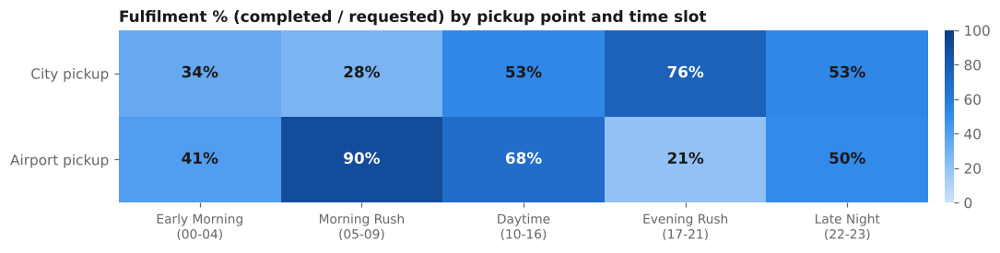
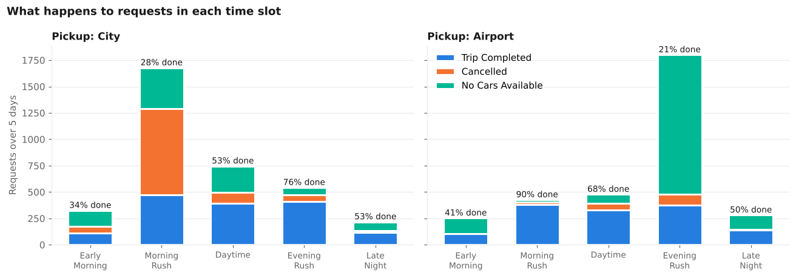
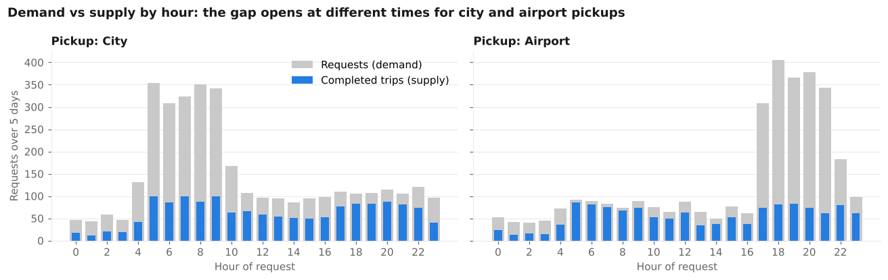
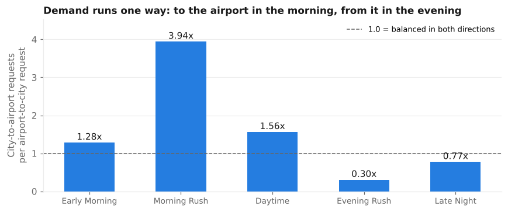
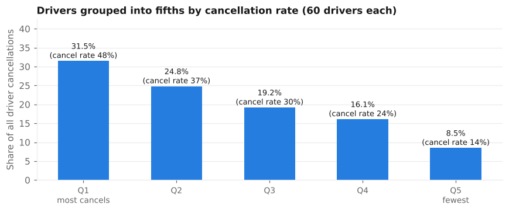

# Ride Supply-Demand Gap Analysis

**Why do 58% of city ⇄ airport ride requests fail, and what would fix it?**

An end-to-end analytics case study on 6,745 ride requests (11-15 July 2016): data cleaning in Python, analysis in SQL
(window functions), an interactive dashboard, sized recommendations and an A/B (switchback) experiment design.

**Interactive dashboard:** [`docs/index.html`](docs/index.html) (open in a browser, or view it live on GitHub Pages:
<https://legitwifi.github.io/ride-supply-demand-gap-analysis/>)



---

## The problem

A ride-hailing platform sees many requests between the city and the airport end in *"No Cars Available"* or a
driver cancellation. Each failed request is lost revenue and a customer who may switch apps. The questions:

1. **Where and when** is the gap between demand (requests) and supply (completed trips) largest?
2. **Why** does it happen?
3. **What** should the business do, how much would it be worth, and how would we test it?

## Data

| | |
|---|---|
| Rows | 6,745 requests (one row per request) |
| Period | Mon 11 - Fri 15 July 2016 |
| Columns | Request id, Pickup point (City / Airport), Driver id, Status, Request timestamp, Drop timestamp |
| Status | Trip Completed · Cancelled (by driver) · No Cars Available |
| Drivers | 300 |

Public, masked dataset from the well-known *Uber Supply-Demand Gap* case study, widely mirrored on Kaggle and GitHub.
The copy used here came from [manaswikamila05/Uber-Supply-Demand-Gap](https://github.com/manaswikamila05/Uber-Supply-Demand-Gap).
It is used for learning purposes only.

**Cleaning** (`src/prep.py`): the two timestamp columns mix formats (`11/7/2016 11:51` and `14-07-2016 19:59:48`), so
they are normalised and parsed day-first. Driver id and drop time are missing exactly when no car was assigned, which
is expected, not an error. Requests are grouped into 5 time slots: Early Morning 00-04, Morning Rush 05-09, Daytime
10-16, Evening Rush 17-21, Late Night 22-23.

## Approach

```
CSV ──► pandas (clean, derive hour / slot) ──► SQLite table `requests`
                                              │
                         sql/analysis.sql (8 named queries: KPIs, GROUP BY, CASE,
                         window functions SUM() OVER, RANK(), NTILE())
                                              │
          ┌───────────────────────────────────┼─────────────────────────────┐
  notebooks/analysis.ipynb          images/*.png (matplotlib)      docs/index.html (Plotly dashboard)
  findings, sizing, experiment
```

## Key findings

**Overall: only 42.0% of requests become trips** (2,831 of 6,745). 1,264 are cancelled by drivers (18.7%) and 2,650
find no car (39.3%).

| Fulfilment % | Early Morning | Morning Rush | Daytime | Evening Rush | Late Night |
|---|---|---|---|---|---|
| **Airport pickup** | 40.7 | 89.7 | 68.4 | **20.7** | 50.5 |
| **City pickup** | 34.2 | **28.1** | 52.9 | 75.8 | 53.0 |

1. **Two slots cause 67% of all failed requests.** Airport pickups in the evening rush (1,427 lost, 73% "No Cars")
   and city pickups in the morning rush (1,205 lost, 49% cancelled by drivers) account for 2,632 of 3,914 failures.

   

2. **The gap is time-of-day specific.** City demand spikes 05-09 and airport demand spikes 17-22, while completed trips
   stay roughly flat.

   

3. **Root cause: one-directional demand.** In the morning there are 3.94 city→airport requests for every airport→city
   request; in the evening only 0.30. Morning drivers end up at the airport with no ride back (a ~52-minute empty
   return), so they cancel city→airport trips. In the evening, cars are in the city when demand is at the airport.

   

4. **Cancellations are concentrated.** The fifth of drivers who cancel most (60 drivers, 48% cancel rate) cause 31.5%
   of all cancellations; the best fifth cancel 14%. 63 drivers cancel more than 40% of their trips.

   

5. **It is structural, not a bad day.** Daily fulfilment stays between 39% and 44% on all five days.

## Sizing the opportunity

| Lever | Extra trips (5 days) | Extra trips / day | Overall fulfilment |
|---|---|---|---|
| Baseline | - | - | 42.0% |
| A. Halve City Morning-Rush cancellations | +410 | +82 | 48.1% |
| B. Lift Airport Evening-Rush fulfilment to 50% (the airport's own late-night level) | +527 | +105 | 49.8% |
| **A + B** | **+937** | **+187** | **55.9%** |

## Recommendations

| # | Problem | Action | Metric to move |
|---|---|---|---|
| 1 | No cars at the airport 17-21 | Pull supply to the airport before 17:00: evening-peak incentive for drivers at the airport, dynamic pricing 17-21 | Airport evening fulfilment %, No-Cars % |
| 2 | Drivers cancel city→airport trips 05-09 | Make the morning airport trip worth it: return-trip priority / guaranteed queue spot, or a bonus per morning airport drop | City morning cancellation % |
| 3 | 20% of drivers cause 31.5% of cancellations | Weekly cancellation scorecard, nudges and coaching for the 63 drivers above 40% | Driver cancellation rate |
| 4 | Ongoing monitoring | Daily dashboard of fulfilment by pickup point × slot with alerts below target | Fulfilment % by slot |

## Experiment design: airport evening supply incentive

* **Hypothesis:** an incentive for drivers to be at the airport during the evening peak lifts airport evening fulfilment
  from ~21%.
* **Design:** switchback by day (alternate incentive and control evenings). Drivers share one supply pool, so a
  driver-level A/B split would leak; switching whole days avoids that.
* **Sample size:** 342 requests per arm to detect 20.7% → 30% (α = 0.05, power 80%). With ~360 airport evening requests
  a day, plan **7 incentive + 7 control evenings** to cover day-to-day variation.
* **Primary metric:** airport fulfilment % 17-21. **Guardrails:** city evening fulfilment, cost per extra trip, driver
  earnings per hour.
* **Decision rule:** roll out if airport evening fulfilment rises by at least 8 points with cost per extra trip below the
  average fare margin, and city evening fulfilment does not fall.

## Limitations

* One week of data, weekdays only; no fares, so value is measured in trips, not revenue.
* Sizing assumes each recovered request becomes a completed trip.
* The directional explanation is inferred from request patterns; driver GPS data would confirm it.

## Repository structure

```
data/uber_request_data.csv     raw data
src/prep.py                    cleaning, time slots, load into SQLite
sql/analysis.sql               all analysis queries (named, reusable)
src/charts.py                  matplotlib charts -> images/
notebooks/analysis.ipynb       full analysis: findings, sizing, recommendations, experiment
src/make_notebook.py           regenerates the notebook
src/build_dashboard.py         builds docs/index.html (Plotly)
docs/index.html                interactive dashboard
images/                        charts used in this README
```

## How to run

```bash
pip install -r requirements.txt

# rebuild the dashboard
python src/build_dashboard.py

# regenerate and run the notebook (also redraws images/)
python src/make_notebook.py
jupyter nbconvert --to notebook --execute --inplace notebooks/analysis.ipynb
```

## Tools

Python (pandas) · SQL (SQLite: CTEs, CASE, window functions) · matplotlib · Plotly · Jupyter

---

**Author:** Rishav Kelwin Toppo · B.Tech ECE, BIT Mesra
